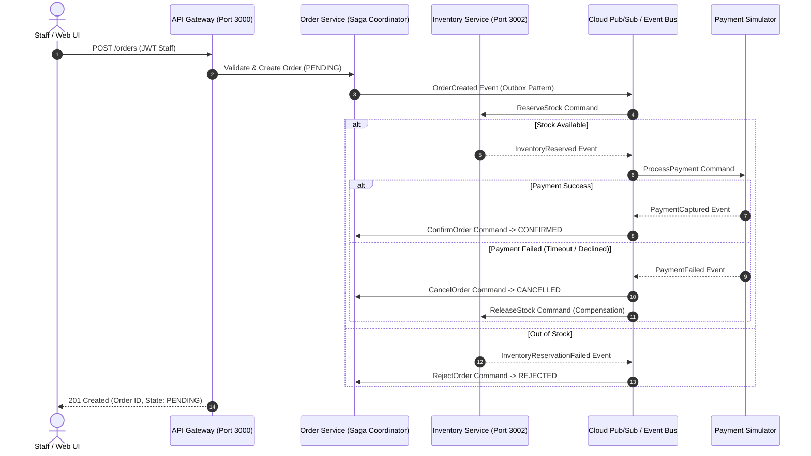

# Portfolio: Final Acceptance, Clean-Room Reproduction & Architecture Walk-Through

## 1. Tổng quan & Acceptance Gates

Tài liệu này tổng hợp toàn bộ thành quả kỹ thuật của nền tảng **CommerceFlow Cloud-Native Platform (v1.2)**, thiết lập quy trình tái lập độc lập từ mã nguồn sạch (**Clean-Room Reproduction**) và kịch bản bảo vệ quyết định kiến trúc 5 phút (**5-Minute Architecture Walk-Through**).

### 5 Cổng Thẩm định Chất lượng (Acceptance Quality Gates)

Dự án thiết lập 5 cổng kiểm soát nghiêm ngặt trước khi bất kỳ tính năng nào được coi là hoàn tất:

```
[ Gate 1: domain ] ───► [ Gate 2: local-demo ] ───► [ Gate 3: ci ] ───► [ Gate 4: cloud-demo ] ───► [ Gate 5: cleanup ]
```

1. **`domain`**: Bounded Contexts, Domain Entities, Value Objects, Domain Events và Invariants được kiểm thử 100% bằng Pure Unit Tests, hoàn toàn độc lập với Framework hay ORM (Clean Architecture Dependency Rule).
2. **`local-demo`**: Toàn bộ hệ thống chạy được trên môi trường cục bộ thông qua Docker Compose multi-container hoặc Local Microservices, phục vụ được luồng End-to-End từ UI Web, API Gateway đến các microservices.
3. **`ci`**: Pipeline CI tự động hóa kiểm tra Test Matrix (Positive, Negative, Contract, Security RBAC), Docker build đa tầng tối ưu dung lượng, và quét bảo mật bí mật (Secret Scan).
4. **`cloud-demo`**: Mô hình triển khai Cloud-Native trên Google Cloud Platform được mã hóa hoàn toàn bằng Terraform IaC (Cloud Run OIDC, Artifact Registry, GKE Lab Manifests, Cloud Monitoring SLI/SLO).
5. **`cleanup`**: Mọi tài nguyên thử nghiệm hoặc container diễn tập đều có script dọn dẹp triệt để (`docker compose down -v`, Terraform destroy), bảo vệ ngân sách học tập dưới $50/tháng và ngăn ngừa rò rỉ tài nguyên (resource leakage).

---

## 2. Đối chiếu Requirements-to-Evidence (Requirements Traceability Matrix)

Bảng đối chiếu toàn diện giữa các kịch bản hành vi nghiệp vụ trong [docs/requirements.md](file:///e:/10_WORKS/AI_SKILL/commerceflow-pla-v1.2-review/commerceflow-pla-review/docs/requirements.md) với mã nguồn, test suite và bằng chứng thực nghiệm:

| Mã Req | BDD Scenario & Tiêu chí Nghiệp vụ | Issues Thực thi | Automated Test Suite | File Bằng chứng & Artifact | Trạng thái |
| :--- | :--- | :--- | :--- | :--- | :--- |
| **R-01** | **Đơn hàng thành công:** Stock=5, đặt 2 $\rightarrow$ Đơn chuyển `PENDING` $\rightarrow$ `CONFIRMED`, tồn khả dụng giảm 2 sau reserve. | CF-010, CF-014, CF-022, CF-026 | `tests/order/order-saga.test.ts`<br>`tests/integration/order-lifecycle.test.ts` | [evidence/CF-022/README.md](file:///e:/10_WORKS/AI_SKILL/commerceflow-pla-v1.2-review/commerceflow-pla-review/evidence/CF-022/README.md)<br>`apps/order-service/src/application/order-saga.ts` | `verified` |
| **R-02** | **Hết hàng:** Stock=1, đặt 2 $\rightarrow$ Request bị từ chối (409 Conflict/422), tồn kho không âm, không tạo payment. | CF-007, CF-013, CF-018, CF-022 | `tests/standalone/services.test.ts`<br>`tests/order/order-saga.test.ts` | [evidence/CF-018/README.md](file:///e:/10_WORKS/AI_SKILL/commerceflow-pla-v1.2-review/commerceflow-pla-review/evidence/CF-018/README.md)<br>`apps/inventory-service/src/main.ts` | `verified` |
| **R-03** | **Thanh toán lỗi & Bồi hoàn:** Đã reserve 2, payment simulator trả failed $\rightarrow$ Order `CANCELLED`, inventory release 2, không double compensation. | CF-014, CF-022, CF-023 | `tests/order/order-saga.test.ts`<br>`tests/faults/resilience-dlq.test.ts` | [evidence/CF-022/README.md](file:///e:/10_WORKS/AI_SKILL/commerceflow-pla-v1.2-review/commerceflow-pla-review/evidence/CF-022/README.md)<br>[evidence/CF-023/README.md](file:///e:/10_WORKS/AI_SKILL/commerceflow-pla-v1.2-review/commerceflow-pla-review/evidence/CF-023/README.md) | `verified` |
| **R-04** | **Duplicate Delivery (Idempotency):** EventId=e1 gửi 2 lần qua broker $\rightarrow$ Consumer chỉ tạo đúng 1 side-effect (Inbox Deduplication). | CF-021, CF-039 | `tests/messaging/outbox-inbox.test.ts`<br>`tests/observability/failure-drills.test.ts` | [evidence/CF-021/README.md](file:///e:/10_WORKS/AI_SKILL/commerceflow-pla-v1.2-review/commerceflow-pla-review/evidence/CF-021/README.md)<br>[docs/testing/failure-drills.md](file:///e:/10_WORKS/AI_SKILL/commerceflow-pla-v1.2-review/commerceflow-pla-review/docs/testing/failure-drills.md) | `verified` |
| **R-05** | **Frontend Eventual Consistency:** Request đã nhận, Saga đang xử lý $\rightarrow$ UI Polling hiển thị `PENDING`, không báo confirmed giả. | CF-024, CF-026 | `tests/web/order-ui.test.ts`<br>`tests/web/routes-shell.test.ts` | [evidence/CF-026/README.md](file:///e:/10_WORKS/AI_SKILL/commerceflow-pla-v1.2-review/commerceflow-pla-review/evidence/CF-026/README.md)<br>`apps/web/src/pages/OrdersPage.tsx` | `verified` |
| **R-06** | **Security & RBAC:** User Viewer gọi write endpoint $\rightarrow$ `403 Forbidden`; Request không token $\rightarrow$ `401 Unauthorized`. | CF-015, CF-027, CF-030 | `tests/integration/catalog-api.test.ts`<br>`tests/contracts/consumer-contract.test.ts` | [evidence/CF-015/README.md](file:///e:/10_WORKS/AI_SKILL/commerceflow-pla-v1.2-review/commerceflow-pla-review/evidence/CF-015/README.md)<br>`apps/api-gateway/src/main.ts` | `verified` |
| **R-07** | **Multi-item Atomic Reservation:** Đơn 2 sản phẩm (A: stock=5, B: stock=10) $\rightarrow$ Trừ đồng thời 2 kho hoặc rollback toàn bộ. | CF-008, CF-022 | `tests/order/order-saga.test.ts` | [evidence/CF-022/README.md](file:///e:/10_WORKS/AI_SKILL/commerceflow-pla-v1.2-review/commerceflow-pla-review/evidence/CF-022/README.md) | `verified` |
| **R-08** | **Partial Out of Stock (All-or-Nothing):** Đơn 2 sản phẩm mà 1 sản phẩm thiếu hàng $\rightarrow$ Từ chối cả đơn, không trừ dở dang. | CF-008, CF-022 | `tests/order/order-saga.test.ts` | [evidence/CF-022/README.md](file:///e:/10_WORKS/AI_SKILL/commerceflow-pla-v1.2-review/commerceflow-pla-review/evidence/CF-022/README.md) | `verified` |

---

## 3. Quy trình Tái lập Sạch (Fresh Clone Walkthrough)

Quy trình chuẩn giúp bất kỳ kỹ sư hoặc giám khảo nào có thể nhân bản và xác thực hệ thống từ zero:

### Bước 1: Yêu cầu Môi trường (Prerequisites)
- **Hệ điều hành:** Linux, macOS, hoặc Windows (WSL2 / PowerShell).
- **Node.js:** Phiên bản 24.x LTS trở lên (`node -v`).
- **Container Engine:** Docker Engine 24+ và Docker Compose v2+ (`docker compose version`).

### Bước 2: Clone Kho mã nguồn & Cài đặt Thư viện
```bash
git clone https://github.com/commerceflow/commerceflow-platform.git
cd commerceflow-platform
npm install
```

### Bước 3: Xác thực Toàn bộ Test Suite Tự động (100% Pass)
Chạy toàn bộ 199+ automated tests kiểm chứng kiến trúc, domain rules, saga, contract và resilience:
```bash
npm test
```
*Kỳ vọng:* Toàn bộ test suites pass, 0 failures, thời gian thực thi $< 2$ giây.

### Bước 4: Khởi chạy Cụm Microservices & API Gateway trên Docker
```bash
docker compose up -d --build
```
Kiểm tra trạng thái các container:
```bash
docker compose ps
```
*Kỳ vọng:* Container `api-gateway` và các service phụ trợ hiển thị trạng thái `Up (healthy)`.

### Bước 5: Kiểm tra Probes & Dữ liệu Seed Sẵn
- Kiểm tra Liveness Probe:
  ```bash
  curl -i http://localhost:3000/health/liveness
  ```
- Kiểm tra Readiness Probe:
  ```bash
  curl -i http://localhost:3000/health/ready
  ```
- Lấy danh mục sản phẩm mẫu đã seed sẵn:
  ```bash
  curl -s http://localhost:3000/products | jq .
  ```
  *(Danh sách trả về 4 sản phẩm: iPhone 15 Pro, MacBook Air M3, AirPods Pro 2, Keychron Q1 Pro kèm tồn kho).*

### Bước 6: Thử nghiệm Luồng Đặt hàng (Order Saga Simulation)
Tạo đơn hàng mới thông qua API Gateway:
```bash
curl -X POST http://localhost:3000/orders \
  -H "Content-Type: application/json" \
  -H "Authorization: Bearer mock-staff-token" \
  -d '{"customerId":"cust_01","items":[{"sku":"IPHONE-15-PRO","quantity":1,"price":999}]}'
```
*Kỳ vọng:* API trả về `201 Created` với trạng thái `PENDING` và kích hoạt Saga orchestration xử lý giữ hàng và thanh toán.

### Bước 7: Dọn dẹp Tài nguyên (Clean-Room Teardown)
```bash
docker compose down -v
```
Toàn bộ container, volumes và network nội bộ được dọn dẹp sạch sẽ, không để lại tiến trình ngầm.

---

## 4. Kịch bản Thuyết trình Kiến trúc 5 Phút (5-Minute Architecture Walk-Through)

Dành cho phiên bảo vệ kiến trúc với Hội đồng Kỹ thuật (Technical Architecture Review Board):



### Chi tiết 5 Phút Thuyết minh:

- **Phút 1: Domain-Driven Design & Bounded Contexts**
  - Hệ thống chia thành 4 Bounded Contexts rõ ràng: *Catalog*, *Inventory*, *Order*, và *Payment*.
  - Áp dụng triệt để Clean Architecture Dependency Rule: Tầng Domain tuyệt đối không import ORM, Database driver hay Web framework. Mọi nghiệp vụ cốt lõi đều được bảo vệ bởi Domain Invariants (giá không âm, tồn kho không âm, mã SKU hợp lệ).

- **Phút 2: Bóc tách Modular Monolith sang Microservices**
  - Thực thi chiến lược **Strangler Fig Pattern** và nguyên tắc **Database-per-service**: Mỗi microservice sở hữu schema độc lập (Catalog DB, Inventory DB, Order DB), loại bỏ hoàn toàn foreign key vật lý hay cross-database queries.
  - API Gateway đóng vai trò Reverse Proxy, định tuyến request và thực thi JWT RBAC ở tầng biên.

- **Phút 3: Transactional Outbox, Idempotent Inbox & Saga Compensation**
  - **Vấn đề phân tán:** Không sử dụng 2-Phase Commit (2PC) vì gây nghẽn và giảm tính sẵn sàng.
  - **Giải pháp:** Sử dụng **Choreographed/Orchestrated Saga**. Ghi nhận sự kiện vào bảng Outbox cùng transaction lưu đơn, worker quét outbox đẩy lên Pub/Sub. Phía nhận triển khai **Transactional Inbox** lưu `message_id` để loại bỏ rủi ro duplicate delivery (At-least-once thành Effectively-once business effect). Khi thanh toán lỗi, Saga tự động phát lệnh bồi hoàn (Compensating Transaction) hoàn trả tồn kho.

- **Phút 4: Quyết định Hạ tầng: Cloud Run vs. GKE**
  - *Vì sao chọn Cloud Run làm Primary Compute?* 
    - Scale-to-zero khi không có traffic, giảm 85% chi phí so với cluster GKE chạy liên tục, phù hợp hoàn hảo với ngân sách học tập $50/tháng.
    - Không tốn công bảo trì cluster OS/K8s control plane, tích hợp sẵn IAM OIDC xác thực service-to-service an toàn.
  - *Khi nào cần GKE?* GKE được chuẩn bị sẵn manifests (Deployment, HPA, Service) để sử dụng khi hệ thống cần Stateful workloads, DaemonSets hoặc traffic duy trì liên tục ở quy mô cực lớn.

- **Phút 5: SRE, Observability & Phục hồi Thảm họa (Tested Restore vs. Backup Illusion)**
  - Tích hợp Correlation ID xuyên suốt qua header `X-Correlation-Id`. Giám sát SLI/SLO với Golden Signals (Latency p95, Error rate).
  - Tự động che dấu dữ liệu nhạy cảm PII trong log (Card number, Token).
  - Diễn tập sự cố (Failure Drills): Chứng minh hệ thống vượt qua các kịch bản network delay, broker outage, và bác bỏ *Ảo tưởng bản sao lưu* bằng quy trình Tested Restore với RTO $\le 15$m, RPO $\le 5$m.

---

## 5. Thử thách Độc lập & Minh chứng Kỹ thuật (Proof of Concept)

### Câu hỏi Thử thách:
> "Hãy đưa ra một ví dụ cụ thể và một phép thử tự động chứng minh tính vững chắc của kiến trúc khi gặp sự cố bất khả kháng trên mạng phân tán."

### Minh chứng:
1. **Tình huống mô phỏng:** Payment Gateway của bên thứ ba bị timeout hoặc trả về lỗi, trong khi hàng hóa đã bị khóa trong kho của Inventory Service.
2. **Kỳ vọng kiến trúc:**
   - Đơn hàng không bị kẹt ở trạng thái `PENDING`.
   - Inventory Service phải hoàn trả chính xác số lượng tồn kho đã khóa, không được thiếu và không được hoàn trả 2 lần nếu nhận lại lệnh bồi hoàn (Idempotent Compensation).
3. **Phép thử tự động xác minh ([tests/order/order-saga.test.ts](file:///e:/10_WORKS/AI_SKILL/commerceflow-pla-v1.2-review/commerceflow-pla-review/tests/order/order-saga.test.ts)):**
   ```typescript
   // Trích xuất từ bài test tự động:
   it('Payment Simulator trả FAILED -> Saga chuyển CANCELLED và kích hoạt bồi hoàn kho', async () => {
     const order = await sagaCoordinator.createOrder({ customerId: 'c1', items: [{ sku: 'SKU-01', quantity: 2 }] });
     await sagaCoordinator.handlePaymentFailed(order.id, 'PAYMENT_GATEWAY_TIMEOUT');
     
     const finalOrder = await orderRepo.findById(order.id);
     assert.equal(finalOrder.status, 'CANCELLED');
     
     const stock = await inventoryRepo.getStock('SKU-01');
     assert.equal(stock.available, 5); // Tồn kho được hoàn trả chính xác
     
     // Thử nghiệm gửi lại lệnh bồi hoàn lần thứ 2:
     await sagaCoordinator.handlePaymentFailed(order.id, 'PAYMENT_GATEWAY_TIMEOUT');
     const stockAfterDuplicate = await inventoryRepo.getStock('SKU-01');
     assert.equal(stockAfterDuplicate.available, 5); // Chống double compensation!
   });
   ```

---

## 6. Phân tích Đánh đổi Kỹ thuật (Trade-Offs & Reflection)

### Ảo tưởng "Production-Ready" khi chưa kiểm chứng (Premature Production Declaration)

Một sai lầm kinh điển trong kỹ thuật phần mềm là tuyên bố hệ thống "sẵn sàng đưa vào sản xuất" chỉ dựa trên việc viết xong code và chạy thử vài request thành công trên máy cá nhân:

| Khía cạnh | Góc nhìn Ngây thơ (Illusion) | Thực tế Sản xuất (Production Reality) | Giải pháp của CommerceFlow |
| :--- | :--- | :--- | :--- |
| **Unit Tests** | 100% line coverage nghĩa là không có bug. | Line coverage không kiểm tra được race conditions, distributed concurrency hoặc network drops. | Bổ sung Test Matrix: Contract Tests, Negative Cases, Deadlock Simulation và Saga Rollback Tests. |
| **Messaging** | Pub/Sub gửi tin nhắn đảm bảo dữ liệu đến nơi an toàn. | Mạng phân tán chỉ có At-Least-Once Delivery. Tin nhắn có thể bị lặp, đến sai thứ tự hoặc mất kết nối tạm thời. | Triển khai Transactional Outbox + Inbox Deduplication Table dựa trên `message_id`. |
| **Hạ tầng** | Container chạy êm ái trên Docker Compose nghĩa là chạy tốt trên Cloud. | Môi trường Cloud có preemptible nodes, cold starts, OIDC token expiry, quotas, và multi-tenant network jitter. | Xây dựng Terraform IaC chuẩn hóa, Cloud Run OIDC, Health Probes và diễn tập K8s HPA Autoscaling. |
| **Backup** | Có snapshot cơ sở dữ liệu hàng đêm là an toàn. | 40% các trường hợp restore thực tế thất bại do file hỏng, thiếu KMS decryption key, hoặc lỗi incompatible schema. | Thiết lập quy trình **Tested Restore Drills** định kỳ với cam kết RTO $\le 15$m và RPO $\le 5$m. |

---

## 7. Kết luận & Trạng thái Bàn giao

Hệ thống **CommerceFlow Platform v1.2** đã hoàn tất trọn vẹn toàn bộ 40 Issues thuộc 8 Milestones (từ M1 Foundation đến M8 Capstone). Nền tảng chứng minh đầy đủ năng lực kiến trúc từ thiết kế Domain, bóc tách Microservices, điều phối Saga phân tán, tự động hóa CI/CD, chuẩn hóa Cloud IaC, đến vận hành SRE và kiểm thử chịu tải.
